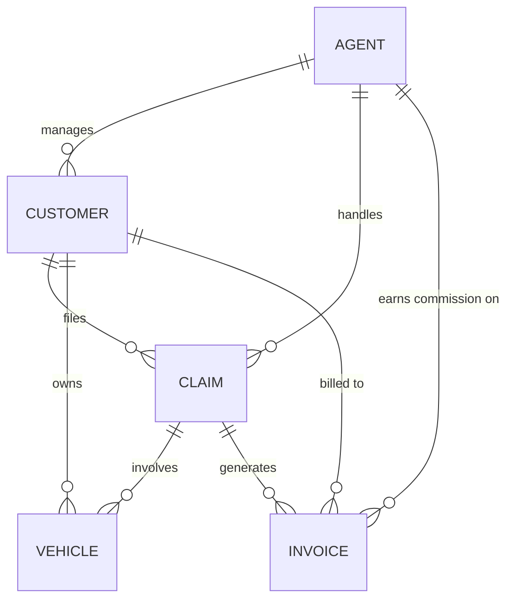

# Ti Vitesse Insurance (TVI) Case Study: Completion Checklist

> **Status (reviewed against `force-app`, after retrieving from org CGICaseStudy):** `[x]` means the metadata or code exists in the repo. Existence is checked, not behavior.
> Known gaps: Invoice has no Last payment date field and no flow sets it (the flow only sets Invoice Date). The monthly commission batch has no scheduler and sums by invoice date, not by cases closed in the month. There are no sharing rules, no region validation, no Invoice create/edit restriction, and no TVI reports or dashboard in the org. The Total Loss counter and the invoice creation are flows, not triggers. Coverage and profile permissions have not been verified.

> Note: the web service document contains credentials (consumer key/secret, password, token). Store them only in Custom Metadata or a Named Credential. Never commit them to source.

## 1. Data model

**Account (agents)**

- [x] Add Mobile (Phone), Email, Total Loss Vehicles Yearly (Number 10,0), Commission rate (Percent), Monthly commission (Number 10,0)
- [x] Add a Region field (needed for the Contact and Case rules, though not listed in the spec)
- [x] Layout related lists: Cases, Invoices, Contacts, Open Activities, Notes
- [x] Layouts: Account Layout - TVI Agents, Account Layout - TVI Managers and Directors

**Contact (customers)**

- [x] Add Mobile and Email (No action taken, these are standard fields)
- [x] Add a Region field, or derive it from the agent's Account (Picklist: Region__c)
- [x] Layout related lists: Cases, Invoices, Vehicles on loan, Activities, Notes (Dynamic Related Lists)
- [x] Layouts: Contact Layout - TVI

**Case (claims)**

- [x] Status values: New, On hold, In progress, Payment, Closed
- [x] Add Date/Time of incident
- [x] Add Damage type (Full, Partial, Total loss)
- [x] Add Damage detail (Long Text 32768), Repair possible (checkbox), Repair details (Long Text 32768)

**Vehicle (`Vehicles__c`)**

- [x] Auto-number name "Vehicle Number"
- [x] Lookups to Contact and Case
- [x] Make picklist (about 130 values) and Colour picklist (15 values)
- [x] Model (Text), Mileage (6,0), Engine capacity (4,0), Year (4,0)
- [x] Registration number: Text(40), required and unique
- [x] Description (Long Text 32000), Start date, End date, Warranty, Total loss
- [x] Enable reports, activities and field history

**Invoice (`Invoices__c`)**

- [x] Auto-number name "Invoice Number"
- [x] Lookups to Account, Case, Contact
- [x] Invoice Date (Date/Time), Amount without VAT (8,2), VAT (Percent)
- [x] Amount with VAT as a formula: `(Amount * Vat) + Amount`
- [ ] Last payment date (Date/Time)
- [ ] Invoice type picklist (Invoice or Credit note), since the spec says invoices and credit notes are stored together
- [x] Enable reports, activities and field history

**Relationships (per the ERD)**

- [x] Customer → Agent, Claim → Agent, Claim → Customer

- [x] Vehicle → Customer, Vehicle → Claim

- [x] Invoice → Agent, Invoice → Claim, Invoice → Customer

## 2. Record types and page layouts

- [x] Vehicle record types: Damaged and On loan
- [x] Damaged layout: Make, Model, Year, Registration number, Description, Mileage, Warranty, Engine capacity, Colour, Total loss
- [x] On loan layout: Make, Model, Year, Start date, End date
- [x] Layouts for Account, Contact, Case and Invoice
- [ ] Search layouts, list views, lookup filters, compact layouts

## 3. Validation rules

- [x] Incident date cannot be in the future
- [x] A case must have an agent (Account) and a customer (Contact)
- [x] After a case is closed, only Closed date and Status can be edited. Agents, their manager and the admin can still modify a closed case.
- [ ] An agent's customers must be in the agent's region
- [ ] Invoices and credit notes can be created and modified by agents only (permissions or a rule)

## 4. Security

**Profiles**

- [x] Admin: full access
- [x] Agent: internal and mobile access, view/create/edit on all records
- [x] Customer: portal (Customer Community) profile only, with create Case and Vehicle, and read-only Invoice
- [ ] Field-level security and object permissions for all three

**Sharing**

- [ ] Case org-wide default set to Private
- [ ] Sharing rule so agents in the same region can view each other's cases
- [x] Role hierarchy (Agent → Manager → Director)
- [ ] Customers see only their own cases and invoices

## 5. Automation

- [x] **Case assignment:** on creation, set Owner to the customer's agent (assignment rule or flow). Check that portal-created cases follow it.
- [x] **Approval process:** an agent can close a case only after manager approval. Include a field update or lock, and email alerts.
- [x] **Invoice creation:** create the invoice when the case Status changes to "Payment"
- [ ] **Invoice date:** set Last payment date to the invoice date plus 3 months
- [x] **Total loss trigger:** after insert of a Total loss damaged vehicle, increment Total Loss Vehicles Yearly on the agent's Account (bulk-safe)
- [x] **Yearly reset:** scheduled job that zeroes Total Loss Vehicles Yearly on January 1
- [x] **Monthly commission:** scheduled batch on the last day of the month. It sets Monthly commission = Commission rate × the invoices of that agent's cases closed that month.
- [x] **Single claim form:** a flow or LWC that creates a Case and a damaged Vehicle together, used by both the agent and the portal customer

## 6. Third-party web service integration

- [x] Custom Metadata Type holding the consumer key, secret, username, password and token (prefer a Named Credential or External Credential, and don't hard-code values)
- [x] Auth class with an OAuth password-flow callout (token retrieval)
- [x] `getVehicles` callout (GET) returning registration number, make, model and year
- [x] `updateVehicle/{RegistrationNumber}` callout (POST) to mark a vehicle as unavailable
- [x] "Assign Vehicle" quick action on Case, backed by a Lightning component or LWC. It lists available vehicles, assigns one to the customer, then calls `updateVehicle`. It must create the on-loan Vehicle record with the Case and Contact.
- [x] Error handling for HTTP and callout failures, without exposing secrets
- [x] `HttpCalloutMock` for the tests

## 7. Visualforce and PDF

- [x] Invoice PDF page (`renderAs="pdf"`) with a controller or extension
- [x] Customer can view the PDF in the portal
- [ ] Customer can send the PDF to their inbox (a button that emails it as an attachment)

## 8. Reports and dashboard

- [ ] Report types for Account, Contact, Case and Vehicle as needed
- [ ] Reports: "Claim by month", "Agent's customer", "Vehicles on rent", "Quarterly closed claims", "Yearly total loss"
- [ ] Dashboard with a chart for each report
- [ ] Dashboard placed on the Home page (Lightning App Builder)
- [ ] Agents have access to the report and dashboard folders

## 9. Application

- [x] Lightning app "TVI Management" with the logo
- [x] Tabs in this order: Home, Accounts, Contacts, Cases, Vehicles, Invoices, Reports, Dashboard
- [ ] App assigned to the Agent and Admin profiles

## 10. Experience Cloud portal (digital experience)

- [x] Enable Digital Experiences and create the site (LWR or Aura)
- [ ] Customer user setup: enable Contacts as portal users
- [ ] Case creation page using the single form from section 5
- [ ] Invoice list and detail pages with the PDF view
- [ ] Guest and customer access settings and branding

## 11. Lightning Web Components

- [x] Combined claim and vehicle form LWC, for internal and portal use
- [x] Assign Vehicle LWC (quick action)
- [ ] Optional: invoice list or PDF viewer component for the portal

## 12. Mobile

- [ ] Configure the Salesforce mobile app for agents: navigation menu, compact layouts, mobile actions and quick actions

## 13. Data migration

- [ ] Review the CSVs and the load order: Accounts → Contacts → Cases → Vehicles → Invoices
- [ ] Load with Data Loader or Data Import Wizard, using external IDs for relationships
- [ ] Verify that triggers, flows and validation rules fire correctly during the load (Case owner assignment, Total Loss counts, invoice dates, region validation)
- [ ] Reconcile record counts and error files

## 14. Testing and quality

- [ ] Apex test classes for the trigger, callout classes (with mocks), batch and scheduled jobs, PDF controller and claim form controller. Cover success, error, empty and bulk (200+ record) cases.
- [x] Code coverage of at least 75% overall (aim higher)
- [ ] Follow naming standards and keep code bulk-safe, with sharing and CRUD/FLS enforced
- [ ] Test each profile: Admin, Agent, Customer
- [ ] End-to-end test: claim → assignment → approval → payment → invoice → PDF → commission
- [ ] Document the setup and deployment steps

## 15. Delivery

- [ ] Deploy and validate (change set or SFDX) and run all tests
